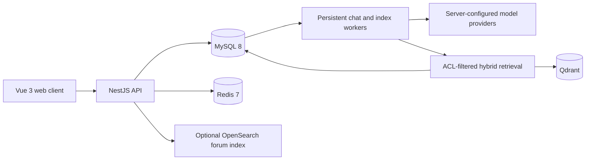

<p align="center"><strong>CHATFORUM</strong></p>
<h1 align="center">Conversations with context.<br>Stories with sources. A place to connect.</h1>
<p align="center">A full-stack AI application combining an assistant, evidence-linked character dialogue, and a community forum.</p>
<p align="center"><a href="https://kato-megumi1.github.io/chatforum-web/">Live application</a> · <a href="https://kato-megumi1.github.io/#work">Watch the demo</a> · <a href="https://kato-megumi1.github.io/">About the author</a> · <a href="README.zh-CN.md">中文说明</a></p>

[](https://kato-megumi1.github.io/#work)

*A 33-second walkthrough recorded by the project owner. Click the preview to watch. The live frontend requires its separately hosted backend to be online.*

## What you can do

- **Talk and create.** Ordinary AI conversations support model selection, optional Agent tools, message attachments, and downloadable file proposals. Changes to a workspace copy require user approval.
- **Stay in character, keep the evidence.** A separate roleplay mode combines character expression with retrieval from an authorized novel library. Source references open the corresponding document revision; character guides are not treated as canonical evidence.
- **Manage a private library.** Users can create their own private knowledge bases. Indexes are built and validated as new versions before an explicit publish step; retrieval and citation access check current permissions.
- **Continue a conversation.** Persistent chat runs stream through SSE and can reconnect by offset. Recent turns and source-linked excerpts provide conversation memory; cross-conversation sharing is off by default and isolated by user and identity.
- **Meet in the forum.** Posts, comments, search, follows, bookmarks, private messages, notifications, and explicitly approved Agent subscriptions share the same application.

The character-retrieval work currently focuses on *Saekano: How to Raise a Boring Girlfriend*. Novel text, prebuilt vectors, user content, and evaluation exports are **not distributed**. Bring material you are authorized to use.

## Architecture



| Layer | Implementation |
| --- | --- |
| Web | Vue 3, TypeScript, Vite, Pinia, Element Plus |
| API and jobs | NestJS, Prisma, persistent runs, worker leases, SSE |
| Data | MySQL 8 with Chinese n-gram search, Redis 7, Qdrant |
| Forum search | Optional OpenSearch CJK/BM25 read model, with SQL revalidation |
| Models | Server-side allowlist for DeepSeek V4 Pro / Qwen3.8-Max; configurable provider credentials; embedding-3 |
| Deployment | Docker Compose, Nginx; a separate static GitHub Pages frontend |

For canonical questions, the retrieval path rewrites the question, snapshots the current index, combines semantic and lexical candidates, reranks and checks evidence, composes a character response, and independently verifies it before delivery. Novel and forum text are untrusted data, not tool instructions.

## Run locally

You need **Node.js 22.13+** and **Docker with Compose**. The commands below create a new local stack. Inspect the plan before running it alongside an existing installation.

```sh
git clone https://github.com/Kato-Megumi1/chatforum.git
cd chatforum
node scripts/setup-local.cjs
```

Set the model keys you intend to use in `backend/.env`. For the default Qwen configuration, supply `DASHSCOPE_API_KEY`; document indexing also needs `EMBEDDING_API_KEY`. The example files contain placeholders, not working credentials. Never put a server key in a `VITE_*` variable.

```sh
node scripts/chatforum-compose.cjs production plan
node scripts/chatforum-compose.cjs production up
node scripts/bootstrap-local.cjs
```

Open **http://localhost:8080**. Local bootstrap credentials are stored in the ignored `.local/admin-bootstrap.env` file; bootstrap preserves existing accounts. The application applies the checked-in Prisma migrations and does not populate a demonstration database.

The independent administration console is mapped only to **127.0.0.1:8091**. Keep it outside public reverse proxies. See [deployment and isolated testing](docs/DEPLOYMENT.md) for optional forum search, local configuration, and the file-review operator.

### Develop without the application container

Start isolated MySQL, Redis, and Qdrant dependencies, and configure `backend/.env` for them. Then:

```sh
npm ci
npm --prefix backend ci --legacy-peer-deps
npm --prefix frontend ci
npm --prefix backend run prisma:generate
npm --prefix backend exec -- prisma migrate deploy
npm run dev:backend
# In another terminal:
npm run dev:frontend
```

The Vite development server uses http://localhost:5173. Native Linux attachment parsing/export requires CJK fonts; the Docker image includes them.

## Verify a change

```sh
npm run build
npm --prefix backend test -- --runInBand
npm --prefix frontend test
node --test scripts/chatforum-compose.spec.cjs
node scripts/check-publication.cjs --staged
```

Database integration suites are opt-in and must use the isolated test configuration. Ordinary checks do not need paid model calls. For browser fixtures and contribution rules, see [CONTRIBUTING.md](CONTRIBUTING.md).

## Project layout

```text
backend/       NestJS modules, workers, Prisma schema and 24 migrations, tests
frontend/      Vue application, responsive UI, frontend tests
docker/        Application image, Nginx, Compose overlays and test services
scripts/       Setup, bootstrap, local operators and synthetic browser checks
docs/          Deployment, architecture and public-release notes
```

## Boundaries and current limits

Credentials stay on the server. Users and documents are checked against current database permissions; a JWT role is not the permission source of truth. The public API has no host shell or Docker socket. File proposals are private copies, and forum-writing tools require a separate user confirmation.

An automatically verified or `grounded` response is not a human accuracy score. Development diagnostics are not a blind benchmark, and this project does not claim million-user load testing, perfect retrieval, or exactly-once external effects. Usage is observed; a request's context capacity and network timeout are separate from a whole-task spending budget.

This public repository starts from a reviewed source snapshot. It excludes private repository history, local configuration, source novels, uploads, databases, prebuilt indexes, private evaluation data, and deployment evidence. See [security](SECURITY.md) and [release scope](docs/OPEN-SOURCE.md).

## License

Original source code is available under the [MIT License](LICENSE). Third-party packages, artwork, names, and marks retain their own rights; see [NOTICE.md](NOTICE.md). No novel corpus or dataset license is granted by this repository.

Built by **[PengYao](https://kato-megumi1.github.io/)**, an incoming graduate student at Tianjin University interested in embodied intelligence and reinforcement learning.
